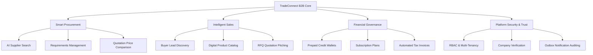
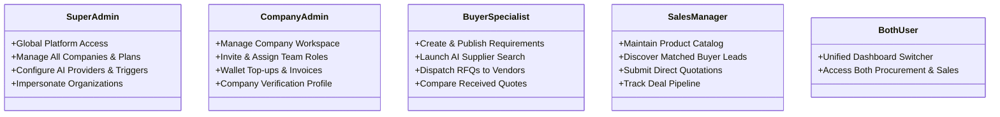

# Chapter 1: Project Overview

---

## 1.1 Executive Overview & Platform Identity

**TradeConnect** (codenamed `procurement_ai`) is a full-featured B2B Procurement and Sales Intelligence Platform engineered to automate the sourcing, supplier pre-qualification, product catalog management, RFQ negotiations, and transactional governance for enterprise organizations.

In conventional B2B trade, buyers spend weeks manually searching business registries, contacting unverified distributors, and negotiating quotes via fragmented email threads. Simultaneously, manufacturers and suppliers struggle to identify high-intent buyer demands matching their production capacities.

TradeConnect solves these inefficiencies by providing:
1. **Autonomous AI Sourcing & Discovery**: Deep semantic matching powered by a dual-engine AI Failover architecture (Google Gemini 2.5 Flash as primary; OpenAI GPT-4o-mini as cloud backup).
2. **Dual-Role Company Architecture**: Flexible organization profiles supporting Buyers (`BUYER`), Vendors (`SELLER`), or Hybrid organizations (`BOTH`).
3. **Structured RFQ & Quotation Lifecycle**: End-to-end deal negotiations, live message threads, dynamic price comparison matrices, and auto-generated PDF quotation dossiers.
4. **Credit Ledger & Subscription Billing**: Prepaid credit wallets, consumption tracking per AI action, automated invoice generation, and tier-based feature gating.
5. **Centralized Notification Engine**: 21 platform-wide operational events configured with Automatic, Manual, or Dual-mode delivery, audit trails, and mandatory security safeguards.
6. **Multi-Tenant Super Admin Console**: Organization impersonation, live metric dashboards, dynamic module toggles, and system-wide audit logging.

---

## 1.2 Core Value Propositions

### Key Business Advantages:
- **Zero Sourcing Latency**: AI-driven web scraping and entity extraction surfaces verified supplier profiles in under 3 seconds.
- **Fail-Safe AI Reliability**: Circuit-breaker gateway automatically switches from Gemini to OpenAI upon HTTP 429 or network timeouts, guaranteeing 99.9% uptime.
- **Strict Multi-Tenant Isolation**: Every enterprise organization operates within an isolated workspace; company members cannot view or modify peer organization records.
- **Transparent Unit Economics**: Companies purchase credits and draw down balances for high-value operations (e.g. unlocking contact details, exporting dossiers, launching deep AI crawlers).

---

## 1.3 User Personas & Permissions

The platform supports six distinct user roles across three organizational tiers:

### 1. Super Administrator (`is_superuser=True`)
- **Access**: Global executive console (`/admin-panel/`).
- **Capabilities**:
  - View cross-platform aggregate metrics (total volume, active companies, GMV, AI queries).
  - Suspend, reactivate, or verify companies with mandatory justification remarks.
  - Temporarily impersonate any company workspace to diagnose customer support issues.
  - Dynamically enable or disable modular cards on Buyer, Seller, and Dual-role dashboards.
  - Configure AI Provider thresholds, failover parameters, and matching algorithms.
  - Manage centralized notification delivery modes, edit templates, and trigger manual operational broadcasts.

### 2. Company Administrator (`role='ADMIN'`)
- **Access**: Organization workspace settings (`/company/profile/`, `/company/team/`, `/company/billing/`).
- **Capabilities**:
  - Maintain corporate tax records, GSTIN/VAT numbers, addresses, and trade certifications.
  - Invite team members, create custom RBAC roles, and assign granular permissions.
  - Monitor credit wallet balance, view consumption ledgers, and download GST tax invoices.
  - Configure company-level notification preferences.

### 3. Procurement Specialist / Buyer User
- **Access**: Procurement desk (`/procurement/`).
- **Capabilities**:
  - Post and manage detailed procurement requirements (specs, target budgets, delivery dates).
  - Execute AI supplier search across verified internal catalogs and external web registries.
  - Dispatch direct or batch RFQs to suppliers.
  - Track quote statuses, negotiate via threaded messaging, and run multi-vendor price comparison matrices.
  - Export supplier dossiers as CSV or formal PDF comparison reports.

### 4. Sales Representative / Seller User
- **Access**: Sales desk (`/sales/`).
- **Capabilities**:
  - Maintain the organization's product and service catalog (SKUs, MOQs, bulk pricing, product images).
  - Discover pre-qualified buyer leads matched by AI algorithms.
  - Submit binding quotations with expiration dates, payment terms, and delivery schedules.
  - Generate official PDF quotation documents for clients.

### 5. Hybrid Enterprise User (`company_type='BOTH'`)
- **Access**: Full dual-role workspace with top-bar role switcher.
- **Capabilities**:
  - Organizations that both manufacture products and source raw materials operate seamlessly without switching logins.
  - Context processors automatically expose both Buyer and Seller navigation menus.

---

## 1.4 High-Level Capability Matrix

| Feature Module | Buyer (`BUYER`) | Seller (`SELLER`) | Dual (`BOTH`) | Super Admin |
| :--- | :---: | :---: | :---: | :---: |
| **Requirements Posting & CSV Import** | Yes | No | Yes | Audit View |
| **Product Catalog Management** | No | Yes | Yes | Audit View |
| **AI Supplier Discovery Engine** | Yes | No | Yes | Activity Log |
| **AI Buyer Lead Discovery Engine** | No | Yes | Yes | Activity Log |
| **RFQ Dispatch & Quote Reception** | Yes | No | Yes | Audit View |
| **Quotation Submission & PDF Export** | No | Yes | Yes | Audit View |
| **Price Comparison Matrix** | Yes | No | Yes | Read-Only |
| **Prepaid Credit Wallet** | Yes | Yes | Yes | Adjust & Top-up |
| **Company Team RBAC Management** | Admin Only | Admin Only | Admin Only | Super Admin Reset |
| **Custom Notification Triggers & Templates** | Receive Only | Receive Only | Receive Only | Full Management |
| **Company Impersonation** | No | No | No | Authorized Only |
