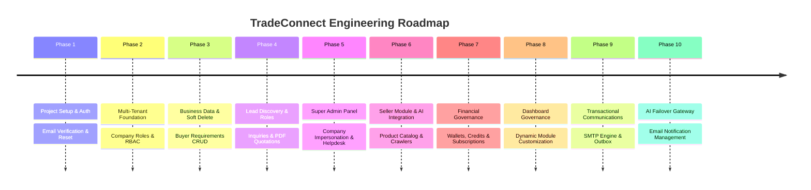

# Chapter 2: Development Roadmap & Historical Evolution

---

## 2.1 Chronological Development Overview

The development history of **TradeConnect** has been reconstructed and verified directly from the repository's Git commit history, configuration changes, and database migrations. The engineering timeline reflects an evolutionary progression from a core Django skeleton to a robust, fault-tolerant B2B enterprise platform.

---

## 2.2 Chronological Phase Breakdown

### Phase 1: Project Setup & Authentication Core
- **Commits**: `4e6d21b`, `f610408`, `d5c1fc1`, `4e3fe26`, `f949531`, `6927a6c`
- **Architectural Scope**:
  - Initialized Django 5.2 project structure with `config/settings.py` and decoupled apps.
  - Configured MySQL connection with `mysqlclient` and UTF8mb4 character set.
  - Implemented custom `User` model inheriting from `AbstractBaseUser` and `PermissionsMixin` with email-based authentication (no username dependency).
  - Built secure registration, session login, email verification tokens, and cryptographic password reset workflows with expiration timeouts.

### Phase 2: Multi-Tenant Architecture & RBAC Foundation
- **Commits**: `56973b7`, `8c0a621`, `318e9bb`
- **Architectural Scope**:
  - Introduced `Company` and `CompanyMember` models to establish organizational tenancy.
  - Implemented company type differentiation: `BUYER`, `SELLER`, and `BOTH`.
  - Created granular permission tables: `CompanyPermission`, `MemberPermission`, `CompanyRole`, and `RolePermission`.
  - Added company team management UI enabling administrators to invite staff and grant specific operational capabilities.

### Phase 3: Business Data Modeling & Soft Delete Pattern
- **Commits**: `367a103`, `bb95036`
- **Architectural Scope**:
  - Implemented the enterprise **Soft Delete pattern** across business data entities (`is_deleted=models.BooleanField(default=False)`, `deleted_at=models.DateTimeField(null=True)`).
  - Built the `Requirement` model and procurement workflow: specifications, budget limits, urgency deadlines, and location criteria.
  - Built full CRUD operations with CSV export and batch CSV import routines.

### Phase 4: Buyer Discovery, Dynamic Roles & Inquiry Engine
- **Commits**: `c3f36d4`, `42ac110`, `e8c7ff6`, `69c20e4`
- **Architectural Scope**:
  - Built the `SavedItem`, `Inquiry`, and `InquiryMessage` models for structured deal negotiations.
  - Introduced automated PDF quotation generation using ReportLab (`inquiry_quotation_pdf_view`).
  - Added Help & Support ticketing system (`SupportTicket`, `FAQ`) and dynamic seller roles management.

### Phase 5: Super Admin Console & Impersonation
- **Commits**: `11469b0`, `250f52e`, `89731ce`
- **Architectural Scope**:
  - Built the centralized executive Super Admin Panel (`/admin-panel/`).
  - Implemented company suspension/reactivation with mandatory audit remarks.
  - Implemented **Company Impersonation**: allows Super Admins to safely assume any company session to troubleshoot issues and exit back to admin status seamlessly.
  - Added global audit logging (`AuditLog`, `APILog`) to record administrative actions.

### Phase 6: Seller Module & AI Discovery Integration
- **Commits**: `5537f1e`, `5d5c4e4`, `920de2a`, `9083993`
- **Architectural Scope**:
  - Implemented the `Product` and `Category` catalog models with multiple product image support.
  - Integrated AI-driven search models: `SearchJob`, `SearchResult`, `ExternalCompany`.
  - Connected background web scrapers with BeautifulSoup and Playwright fallbacks for automated entity extraction.

### Phase 7: Credit Wallets, Subscriptions & Financial Governance
- **Commits**: `9d6b0a9`, `776f75d`, `fc470b2`
- **Architectural Scope**:
  - Implemented `CompanyCreditWallet`, `SubscriptionPlan`, `Subscription`, and `CreditTransaction`.
  - Established unit economics: defined credit costs for AI supplier searches, contact unlocks, and dossier exports (`FeatureCreditCost`).
  - Added automated tax invoice generation (`Invoice`) and balance deduction safeguards.

### Phase 8: Dashboard Governance & Module Synchronization
- **Commits**: `42eb1a7`, `8054e02`, `5a58953`, `351a689`, `8784b00`, `41d2d4b`
- **Architectural Scope**:
  - Developed dynamic layout customizers: `BuyerDashboardLayout`, `SellerDashboardLayout`, `BothDashboardLayout`.
  - Allowed Super Admins to toggle individual module cards and widgets on and off dynamically without deploying code.
  - Synchronized company type transitions (`BUYER` ↔ `SELLER` ↔ `BOTH`) with real-time UI updates.

### Phase 9: Automated Transactional Email & Outbox Architecture
- **Commits**: `df4c7c1`, `548becd`
- **Architectural Scope**:
  - Integrated live SMTP delivery with environment and database configuration (`SMTPSetting`).
  - Implemented TradeConnect 2-card responsive master email layout with brand header, hero banner, trust badges, and dark footer.
  - Implemented RFC 8058 One-Click Unsubscribe compliance (`List-Unsubscribe` headers and cryptographic tokens).

### Phase 10: Sales Pre-Qualification, AI Failover Gateway & Advanced Notification Management
- **Commits**: `6205b33`, `d1d5943`, `c7bb68b`
- **Architectural Scope**:
  - Fixed pre-qualified customer discovery pipelines and dynamic AI matching criteria parameters.
  - Architected **`AIFailoverGateway`**: primary Google Gemini 2.5 Flash with automatic cloud failover to OpenAI GPT-4o-mini on HTTP 429, HTTP 503, or timeout.
  - Implemented **Centralized Notification Management**: 21 platform events, delivery mode contracts (`AUTOMATIC`, `MANUAL`, `BOTH`), mandatory security auth lockouts, credit threshold/cooldown enforcement, live preview API, and Super Admin test send.

### Phase 11: In-App System Notification Center & Multi-Channel Event Routing
- **Architectural Scope**:
  - Engineered dedicated In-App Notification Center complementing transactional email communications.
  - Implemented multi-channel rule routing (`IN_APP`, `EMAIL`, `BOTH`) configurable per event in Super Admin Console.
  - Added notification bell 🔔 with live unread counter badge, dropdown panel, and 20s interval polling.
  - Created dedicated full-featured Notification Center Inbox page (`/notifications/inbox/`) with status tabs (All, Unread, Read, Important, Archived) and search filtering.
  - Enhanced `Notification` model with priority levels (`INFO`, `SUCCESS`, `WARNING`, `CRITICAL`), event keys, and soft-archive flags (`is_archived`).
  - Delivered complete REST APIs: `GET /api/notifications/`, `GET /api/notifications/unread-count/`, `POST /api/notifications/<id>/mark-read/`, `POST /api/notifications/<id>/mark-unread/`, `POST /api/notifications/mark-all-read/`, and `POST /api/notifications/<id>/archive/`.
  - Built comprehensive automated test suite verifying tenant isolation, multi-channel dispatch, and REST APIs (50/50 tests passing).

---

## 2.3 Verification Matrix of Implemented Milestones

| Milestone / Capability | Git Commit Reference | Verification Method | Status |
| :--- | :---: | :--- | :---: |
| Custom User Auth & Password Reset | `f610408`, `4e3fe26` | Automated test suite (`apps.accounts`) | Verified |
| Multi-Tenant Isolation & RBAC | `56973b7`, `318e9bb` | Automated test suite (`apps.companies`) | Verified |
| Requirements & Product Catalog | `bb95036`, `9083993` | CRUD integration tests | Verified |
| Inquiries & PDF Quotations | `e8c7ff6` | ReportLab PDF generator tests | Verified |
| Super Admin Impersonation & Controls | `89731ce` | Admin views test suite | Verified |
| Credit Wallets & Subscription Billing | `fc470b2` | Wallet ledger tests (`apps.billing`) | Verified |
| AI Search & Cloud Failover Gateway | `c7bb68b` | Gateway mock error tests (`apps.ai_search`) | Verified |
| 21-Event Email Notification Hub | Latest | 43 automated unit/integration tests | Verified |
| In-App Notification Center & APIs | Latest | 50 automated tests (`apps.notifications.tests`) | Verified |
