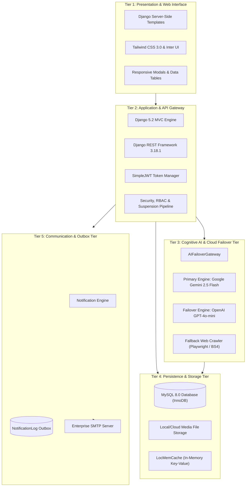
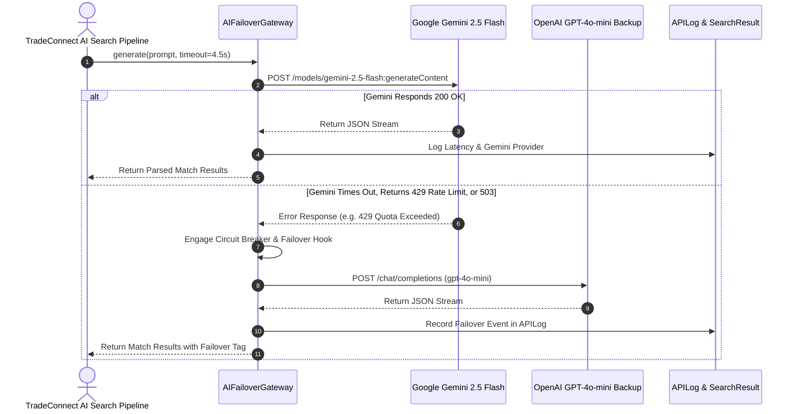
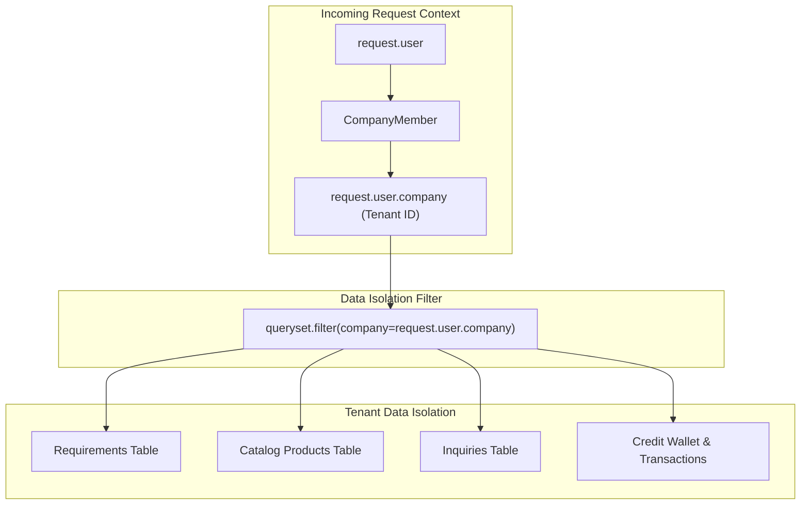

# Chapter 3: System Architecture

---

## 3.1 Five-Tier Architectural Model

TradeConnect is engineered around a modular, resilient **5-Tier Architecture** that enforces clear separation of concerns, high throughput, and enterprise-grade fault tolerance:



---

## 3.2 Tier Breakdown & Internal Mechanics

### 1. Presentation & Web Interface (Tier 1)
- **Engine**: Django server-rendered HTML templates utilizing template inheritance (`templates/base.html`).
- **Styling**: Tailwind CSS utility framework supplemented with FontAwesome 6 icons and Google Inter typography.
- **Interactivity**: Modal dialogs, dynamic filter pills, and client-side AJAX requests (without heavy single-page application framework overhead).

### 2. Application & API Gateway (Tier 2)
- **Django Core**: Dispatches incoming HTTP requests through WSGI/ASGI handlers, viewsets, and class-based/function-based views.
- **Django REST Framework**: Exposes authenticated REST endpoints with token authentication (`Bearer <jwt_token>`) and session fallbacks.
- **Middleware Pipeline**:
  ```mermaid
  sequenceDiagram
      autonumber
      actor User as Client Browser / API
      participant Sec as SecurityMiddleware
      participant Sess as SessionMiddleware
      participant Cors as CorsMiddleware
      participant Csrf as CsrfViewMiddleware
      participant Auth as AuthenticationMiddleware
      participant Susp as CompanySuspensionMiddleware
      participant View as Target View Handler

      User->>Sec: Incoming Request
      Sec->>Sess: Load Session Data
      Sess->>Cors: Check Allowed Origins
      Cors->>Csrf: Validate CSRF Token (POST/PUT/DELETE)
      Csrf->>Auth: Attach request.user (Session or JWT)
      Auth->>Susp: Verify Company Active Status
      alt Company is Suspended
          Susp-->>User: Auto-logout & 403 Forbidden redirect
      else Company is Active
          Susp->>View: Execute View Logic & Return Response
      end
  ```

### 3. Cognitive AI & Cloud Failover Tier (Tier 3)
The AI engine implements a **Circuit-Breaker Cloud Failover Architecture** to guarantee that user queries never fail due to upstream API rate limits or provider downtime:



### 4. Persistence & Storage Tier (Tier 4)
- **RDBMS**: MySQL 8.0 with InnoDB transactional engine, foreign key constraints, and UTF8mb4 encoding supporting international trade characters and emojis.
- **Soft Deletion**: Business data models inherit `is_deleted` and `deleted_at` fields to protect historical financial and audit data from accidental hard deletions.
- **Media**: Securely isolated storage for product catalog photos and verification tax documents in `media/`.

### 5. Communication & Outbox Tier (Tier 5)
- **Transactional Outbox Pattern**: When an event occurs, an immutable record is committed to `NotificationLog` with status `PENDING` before delivery is attempted.
- **Asynchronous / Non-Blocking Dispatch**: Transmission runs on dedicated background daemon threads (`threading.Thread`) or Celery workers so user requests never experience latency spikes.
- **Exponential Backoff Retries**: Transient SMTP connection failures are rescheduled with bounded exponential delays (`retry_after`).
- **RFC 8058 Compliance**: Every outgoing operational email embeds verified `List-Unsubscribe` headers and cryptographic one-click unsubscribe links.

---

## 3.3 Multi-Tenant Isolation Model

TradeConnect utilizes a **Shared Database, Shared Schema, Tenant-Column Isolation** architecture:



### Isolation Guarantees:
1. **Model-Level Foreign Keys**: Every business entity links to `Company` (`ForeignKey(Company, on_delete=models.CASCADE)`).
2. **View-Level Scoping**: All search, list, detail, and export queries apply strict filtering against `request.user.company`.
3. **Cross-Company Access Denial**: Direct ID manipulation in URL routes (`/procurement/requirements/<pk>/`) is validated against tenant ownership; foreign tenant IDs trigger immediate `404 Not Found` or `403 Forbidden` responses.
4. **Super Admin Impersonation**: Only authenticated Super Admins can explicitly assume a tenant's session state, recorded in the audit log with the initiating admin's identity.
