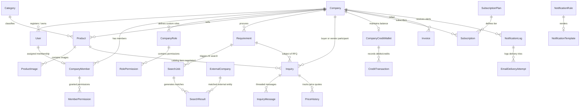

# Chapter 4: Database Design & Entity Relationship Diagrams (ERD)

---

## 4.1 Complete Database Model Inventory (49 Models)

The TradeConnect schema consists of **49 verified database models** distributed across 9 local Django applications:

| Application | Model Count | Model Names | Primary Purpose |
| :--- | :---: | :--- | :--- |
| **`apps.accounts`** | 1 | `User` | Custom email-based user identity & permissions |
| **`apps.companies`** | 6 | `Company`, `CompanyMember`, `CompanyPermission`, `MemberPermission`, `CompanyRole`, `RolePermission` | Multi-tenant organization boundaries, memberships, and dynamic RBAC |
| **`apps.catalog`** | 3 | `Category`, `Product`, `ProductImage` | Vendor product catalog, hierarchical categories, and product images |
| **`apps.requirements`** | 1 | `Requirement` | Buyer procurement requests, technical specifications, and budgets |
| **`apps.ai_search`** | 6 | `SearchJob`, `ExternalCompany`, `SearchResult`, `APILog`, `MatchingParameter`, `PlatformMatchingCriteria` | Autonomous search crawler, AI match scoring, and provider failover logs |
| **`apps.leads`** | 4 | `SavedItem`, `Inquiry`, `InquiryMessage`, `PriceHistory` | Deal negotiation threads, quotations, bookmarks, and price audit history |
| **`apps.billing`** | 11 | `SubscriptionPlan`, `Subscription`, `CompanyCreditWallet`, `FeatureCreditCost`, `CreditTransaction`, `UsageRecord`, `Payment`, `Invoice`, `CompanyWallet`, `WalletTransaction`, `ServicePricing` | Prepaid credit ledgers, plans, payments, and tax invoices |
| **`apps.dashboard`** | 10 | `ActivityLog`, `SupportTicket`, `Notification`, `FAQ`, `PlatformSetting`, `BuyerModuleConfig`, `BuyerDashboardLayout`, `SellerModuleConfig`, `SellerDashboardLayout`, `BothDashboardLayout` | User activities, helpdesk tickets, and dynamic dashboard layouts |
| **`apps.notifications`** | 7 | `NotificationTemplate`, `NotificationRule`, `NotificationPreference`, `NotificationLog`, `EmailDeliveryAttempt`, `SMTPSetting`, `EmailLayoutSetting` | Centralized notification management, outbox delivery, and SMTP configs |

---

## 4.2 Core Entity Relationship Diagram (ERD)

---

## 4.3 Detailed Schema Specifications by App

### 1. `apps.accounts`
- **`User`**:
  - `id`: BigAutoField (Primary Key)
  - `email`: EmailField (Unique, Normalized, Indexed)
  - `first_name`, `last_name`: CharField(max_length=150)
  - `is_active`: BooleanField (Default: True)
  - `is_staff`: BooleanField (Default: False)
  - `is_superuser`: BooleanField (Default: False)
  - `failed_login_attempts`: PositiveIntegerField (Default: 0, Triggers security lock at 5)
  - `last_login_ip`: GenericIPAddressField (Nullable)
  - `email_verified`: BooleanField (Default: False)
  - `verification_token`: CharField(max_length=100, Nullable)
  - `password_reset_token`: CharField(max_length=100, Nullable)
  - `password_reset_sent_at`: DateTimeField (Nullable)

### 2. `apps.companies`
- **`Company`**:
  - `id`: BigAutoField (Primary Key)
  - `name`: CharField(max_length=255, Indexed)
  - `company_type`: CharField(choices=[`BUYER`, `SELLER`, `BOTH`], Default: `BUYER`)
  - `gst_vat_no`: CharField(max_length=50, Blank=True)
  - `pan_tax_id`: CharField(max_length=50, Blank=True)
  - `is_verified`: BooleanField (Default: False)
  - `is_suspended`: BooleanField (Default: False)
  - `suspension_reason`: TextField (Blank=True)
  - `is_deleted`: BooleanField (Default: False)
  - `deleted_at`: DateTimeField (Nullable)
- **`CompanyMember`**:
  - `company`: ForeignKey(Company, on_delete=CASCADE)
  - `user`: OneToOneField(User, on_delete=CASCADE)
  - `role`: CharField(choices=[`ADMIN`, `USER`], Default: `USER`)
  - `is_active`: BooleanField (Default: True)

### 3. `apps.catalog` & `apps.requirements`
- **`Category`**: `name`, `slug` (Unique), `parent` (Self-referencing ForeignKey), `is_active`.
- **`Product`**:
  - `company`: ForeignKey(Company, on_delete=CASCADE)
  - `category`: ForeignKey(Category, on_delete=SET_NULL, Nullable)
  - `title`: CharField(max_length=255, Indexed)
  - `description`: TextField
  - `price`: DecimalField(max_digits=12, decimal_places=2)
  - `moq`: PositiveIntegerField (Minimum Order Quantity)
  - `is_available`: BooleanField (Default: True)
  - `is_deleted`: BooleanField (Soft Delete)
- **`Requirement`**:
  - `company`: ForeignKey(Company, on_delete=CASCADE)
  - `title`: CharField(max_length=255)
  - `specifications`: TextField
  - `target_price`: DecimalField(max_digits=12, decimal_places=2)
  - `target_quantity`: PositiveIntegerField
  - `deadline`: DateField
  - `status`: CharField(choices=[`DRAFT`, `OPEN`, `IN_NEGOTIATION`, `FULFILLED`, `CANCELLED`])
  - `is_deleted`: BooleanField (Soft Delete)

### 4. `apps.ai_search`
- **`SearchJob`**:
  - `company`: ForeignKey(Company)
  - `user`: ForeignKey(User)
  - `query`: CharField(max_length=255)
  - `search_type`: CharField(choices=[`SUPPLIER_DISCOVERY`, `BUYER_DISCOVERY`])
  - `status`: CharField(choices=[`PENDING`, `RUNNING`, `COMPLETED`, `FAILED`])
  - `provider_used`: CharField(max_length=100, e.g. "Google Gemini 2.5 Flash")
  - `failover_triggered`: BooleanField (Default: False)
  - `failover_reason`: CharField(max_length=255, Blank=True)
- **`SearchResult`**:
  - `job`: ForeignKey(SearchJob, on_delete=CASCADE)
  - `company_name`: CharField(max_length=255)
  - `match_score`: DecimalField(max_digits=5, decimal_places=2, e.g. 96.50%)
  - `match_reasons`: JSONField
  - `contact_email`, `phone_number`, `website_url`: CharField
  - `is_contact_unlocked`: BooleanField (Default: False)
- **`APILog`**:
  - `provider`: CharField (Gemini, OpenAI, Scraper)
  - `endpoint`: CharField
  - `status_code`: IntegerField
  - `latency_ms`: FloatField
  - `is_failover`: BooleanField

### 5. `apps.leads`
- **`Inquiry`**:
  - `requirement`: ForeignKey(Requirement, Nullable)
  - `product`: ForeignKey(Product, Nullable)
  - `buyer_company`: ForeignKey(Company, related_name="sent_inquiries")
  - `seller_company`: ForeignKey(Company, related_name="received_inquiries")
  - `status`: CharField(choices=[`PENDING`, `ACCEPTED`, `QUOTED`, `REJECTED`, `CLOSED`])
  - `quoted_price`: DecimalField(max_digits=12, decimal_places=2, Nullable)
- **`InquiryMessage`**:
  - `inquiry`: ForeignKey(Inquiry, on_delete=CASCADE)
  - `sender`: ForeignKey(User)
  - `message`: TextField
  - `attachment`: FileField (Nullable)

### 6. `apps.billing`
- **`CompanyCreditWallet`**:
  - `company`: OneToOneField(Company)
  - `subscription_credits`: PositiveIntegerField (Default: 0)
  - `purchased_credits`: PositiveIntegerField (Default: 0)
  - `total_available`: Property calculating `subscription + purchased - reserved`
- **`CreditTransaction`**:
  - `wallet`: ForeignKey(CompanyCreditWallet)
  - `transaction_type`: CharField(choices=[`CREDIT`, `DEBIT`, `REFUND`])
  - `amount`: DecimalField(max_digits=10, decimal_places=2)
  - `action_type`: CharField(e.g. `AI_SEARCH`, `CONTACT_UNLOCK`, `REPORT_EXPORT`)
  - `balance_after`: DecimalField(max_digits=10, decimal_places=2)

### 7. `apps.notifications`
- **`NotificationRule`**:
  - `event_key`: CharField(max_length=100, Unique, Indexed)
  - `name`: CharField(max_length=150)
  - `target_audience`: CharField(choices=[`USER`, `COMPANY_ADMIN`, `SUPER_ADMIN`])
  - `delivery_mode`: CharField(choices=[`AUTOMATIC`, `MANUAL`, `BOTH`])
  - `template`: ForeignKey(NotificationTemplate)
  - `is_mandatory_auth`: BooleanField (Security lock)
  - `threshold_value`: DecimalField(Nullable)
  - `cooldown_hours`: PositiveIntegerField(Default: 24)
- **`NotificationLog`**:
  - `rule`: ForeignKey(NotificationRule)
  - `recipient_email`: EmailField
  - `delivery_mode`: CharField
  - `sent_by`: ForeignKey(User, Nullable, Operator audit)
  - `status`: CharField(choices=[`PENDING`, `SENDING`, `SENT`, `FAILED`, `CANCELLED`])
  - `attempts_count`: PositiveIntegerField(Default: 0)
  - `retry_after`: DateTimeField(Nullable)
