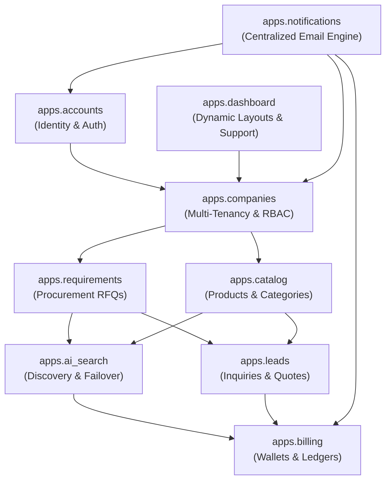

# Chapter 5: Code Explanation & Module-by-Module Guide

---

## 5.1 Architecture Overview for Junior Developers

In TradeConnect, code is organized into **nine modular Django applications** within the `apps/` directory. Each app adheres to the **Single Responsibility Principle (SRP)**:



---

## 5.2 Module Explanations

### 1. `apps.accounts` (User Identity, Tokens & Security)
- **What it does**: Handles user registration, email verification, session authentication, JWT token issuance, and password recovery.
- **Why it exists**: Provides an email-first, secure identity foundation that is decoupled from organization structures (users can exist independently before joining a company).
- **Key Files**:
  - `models.py`: Custom `User` model using `AbstractBaseUser`.
  - `web_views.py`: Server-rendered views for `login_view`, `register_view`, `forgot_password_view`, and `reset_password_view`.
  - `api_views.py`: DRF endpoints returning JWT access and refresh token pairs.
- **Inputs & Outputs**:
  - *Input*: Email, raw password, verification tokens.
  - *Output*: Authenticated user session, `access_token`, `refresh_token`, or redirect to dashboard.
- **Data Flow**:
  ```
  User Registration Request ──> User.objects.create_user() ──> Generate Verification Token 
  ──> Trigger 'auth.welcome' Email ──> Redirect to Login
  ```

---

### 2. `apps.companies` (Multi-Tenancy, Roles & Organization Lifecycle)
- **What it does**: Defines tenant isolation, company verification, team memberships, custom RBAC permissions, and the Super Admin company suspension firewall.
- **Why it exists**: Ensures that data belonging to "Company A" is strictly segregated from "Company B" and prevents suspended organizations from accessing platform resources.
- **Key Files**:
  - `models.py`: `Company`, `CompanyMember`, `CompanyRole`, `RolePermission`.
  - `middleware.py`: `CompanySuspensionMiddleware` checks if `request.user.company.is_suspended` is true; if so, it forcibly logs out the user and invalidates all session keys.
  - `admin_views.py`: Super Admin operations (company verification toggle, suspension with mandatory remarks, impersonation launcher).
- **Code Example (Suspension Protection)**:
  ```python
  # apps/companies/middleware.py
  class CompanySuspensionMiddleware:
      def __call__(self, request):
          if request.user.is_authenticated and not request.user.is_superuser:
              company = getattr(request.user, "company", None)
              if company and company.is_suspended:
                  auth_logout(request)
                  messages.error(request, f"Your company account has been suspended: {company.suspension_reason}")
                  return redirect("login")
          return self.get_response(request)
  ```

---

### 3. `apps.catalog` (Products, Categories & Availability)
- **What it does**: Allows sellers and hybrid organizations to maintain a public/private catalog of goods, technical specifications, bulk pricing tiers, and photo galleries.
- **Why it exists**: Serves as the ground-truth product index queried by the AI supplier discovery engine.
- **Key Files**:
  - `models.py`: `Product`, `Category`, `ProductImage`.
  - `web_views.py`: Product listing, batch CSV import, dynamic availability toggle, and CSV export.

---

### 4. `apps.requirements` (Buyer Procurement Requests)
- **What it does**: Allows purchasing specialists to submit procurement RFQs specifying required product grades, target budgets, delivery dates, and destination ports.
- **Why it exists**: Forms the structured demand signals that trigger autonomous AI vendor discovery and supplier matching algorithms.
- **Key Files**:
  - `models.py`: `Requirement`.
  - `web_views.py`: Requirement CRUD, batch CSV import template, and direct "Find Suppliers" action.

---

### 5. `apps.ai_search` (Cognitive AI Gateway & Failover Engine)
- **What it does**: Runs semantic and heuristic matching between buyer requirements and potential suppliers across internal databases and external web registries.
- **Why it exists**: Manual vendor sourcing is slow; autonomous AI sourcing finds matching verified businesses and generates match justification scores in seconds.
- **Key Files**:
  - `services/ai_gateway.py`: `AIFailoverGateway` managing primary Google Gemini 2.5 Flash and OpenAI GPT-4o-mini failover.
  - `services/ai_matcher.py`: Multi-factor scoring (catalog match, location proximity, price alignment, certification bonuses).
  - `services/search_provider.py`: Scrapes external supplier registries and populates `ExternalCompany` and `SearchResult` records.
- **Code Example (Failover Execution)**:
  ```python
  # apps/ai_search/services/ai_gateway.py
  try:
      # 1. Primary Engine: Google Gemini 2.5 Flash
      raw_res = requests.post(gemini_url, json=gemini_payload, timeout=4.5)
      if raw_res.status_code == 200:
          return cls._parse_response(raw_res.json()), {"engine": "Gemini", "failover": False}
      raise RuntimeError(f"Gemini HTTP {raw_res.status_code}")
  except Exception as exc:
      # 2. Cloud Failover Engine: OpenAI gpt-4o-mini Backup
      logger.warning(f"Primary AI failure ({exc}). Engaging failover to OpenAI...")
      raw_res = requests.post(openai_url, json=openai_payload, timeout=6.0)
      return cls._parse_response(raw_res.json()), {"engine": "OpenAI Backup", "failover": True, "reason": str(exc)}
  ```

---

### 6. `apps.leads` (Deal Negotiations, Inquiries & PDF Quotes)
- **What it does**: Orchestrates commercial inquiries (RFQs) between buyers and sellers, threaded messaging, counter-offers, price history tracking, and PDF quote compilation.
- **Why it exists**: Eliminates unorganized offline email negotiations by centralizing binding quotations and providing automated price comparison tables.
- **Key Files**:
  - `models.py`: `Inquiry`, `InquiryMessage`, `SavedItem`, `PriceHistory`.
  - `pdf_views.py`: Generates official PDF quotations with organization letterheads, GSTIN calculations, and digital verification badges using ReportLab.

---

### 7. `apps.billing` (Prepaid Credit Wallets, Subscriptions & Invoicing)
- **What it does**: Implements a double-entry style prepaid credit ledger, tracks per-action credit consumption, manages recurring subscriptions, and generates GST tax invoices.
- **Why it exists**: Monetizes platform capabilities and controls API resource exhaustion by requiring credits for contact unlocks and AI queries.
- **Key Files**:
  - `models.py`: `CompanyCreditWallet`, `CreditTransaction`, `SubscriptionPlan`, `Subscription`, `Invoice`.
  - `services/wallet.py`: Atomically debits credits (`select_for_update()`) and checks wallet balances before executing AI discovery tasks.

---

### 8. `apps.dashboard` (Dynamic Layouts, Module Governance & Helpdesk)
- **What it does**: Renders tailored operational dashboards for Buyers, Sellers, and Dual-role companies, and allows Super Admins to dynamically enable/disable dashboard cards.
- **Why it exists**: Different business personas require distinct visual telemetry (e.g. buyers care about pending RFQs; sellers care about pipeline leads).
- **Key Files**:
  - `models.py`: `BuyerDashboardLayout`, `SellerDashboardLayout`, `SupportTicket`, `FAQ`, `PlatformSetting`.
  - `views.py`: Dashboard router directing users to their appropriate company-type layout.

---

### 9. `apps.notifications` (Centralized Email Notification Management)
- **What it does**: Controls 21 platform operational notifications, enforces delivery mode policies (`AUTOMATIC`, `MANUAL`, `BOTH`), manages outbox queues, and renders responsive 2-card email layouts.
- **Why it exists**: Provides centralized Super Admin visibility over platform communications, prevents alert flooding via cooldown windows, and ensures mission-critical security emails cannot be deactivated.
- **Key Files**:
  - `models.py`: `NotificationRule`, `NotificationTemplate`, `NotificationLog`, `SMTPSetting`.
  - `services/email_engine.py`: `trigger_email_notification()`, `deliver_notification_log()`, and `build_branded_html()`.
  - `admin_views.py`: Super Admin Notification Console at `/admin-panel/email/triggers/`.
