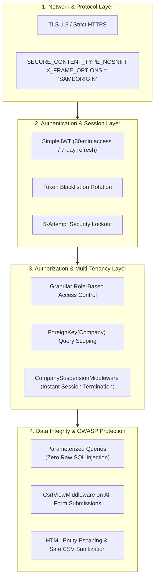

# Chapter 9: Security Hardening & Performance Optimization

---

## 9.1 Multi-Tenant Security & Access Control

TradeConnect enforces a multi-layered security model ensuring complete data confidentiality across participating organizations:



---

## 9.2 Critical Security Safeguards

### 1. Mandatory Authentication Notification Protection
To prevent rogue administrators or compromised sessions from disabling security notifications:
- In `apps/notifications/models.py`, `NotificationRule.is_mandatory_auth` designates mission-critical security workflows (`auth.password_reset`, `auth.email_verification`).
- The toggle controller (`admin_email_trigger_toggle_view`) and rule updater (`admin_email_trigger_edit_view`) explicitly reject any request that attempts to set `is_enabled = False` on mandatory authentication rules, returning an HTTP 400 error.

### 2. Immediate Suspension & Session Eviction
When an administrator suspends a company (`is_suspended=True`):
- `CompanySuspensionMiddleware` checks company status on every subsequent HTTP request.
- If a user belongs to a suspended company, Django automatically invalidates their session cookies (`django.contrib.auth.logout(request)`), purges cached data, and redirects to the login screen with the administrator's official remark.

### 3. Repeated Authentication Alert & Lockout
- In `apps/accounts/web_views.py`, failed login attempts increment `user.failed_login_attempts`.
- Reaching 5 consecutive failures triggers an immediate `admin.security_alert` notification to Super Administrators containing the originating IP address and timestamp.

### 4. Zero Secret Logging
- Audit logs (`AuditLog`, `NotificationLog`, `APILog`) record metadata only.
- Raw passwords, plain-text reset tokens, verification hashes, credit card numbers, and API keys are strictly scrubbed before saving logs.

---

## 9.3 Database & Query Performance Optimization

### 1. Elimination of N+1 Queries
In high-volume views (e.g. `inquiries_list_view` and `admin_email_triggers_view`), naive ORM calls trigger separate queries for each foreign key. TradeConnect resolves this using eager loading:

```python
# Before (Inefficient: 1 query for rules + N queries for templates)
rules = NotificationRule.objects.all()

# After (Optimized: 1 single JOIN query)
rules = NotificationRule.objects.all().select_related("template")

# For Many-to-Many / Reverse Foreign Keys (2 queries total regardless of volume)
companies = Company.objects.filter(is_deleted=False).prefetch_related("members")
```

### 2. Strategic Database Indexing
Indexes are created on frequently filtered and sorted columns:
- `apps.accounts.User`: `email` (Unique Index, B-Tree).
- `apps.companies.Company`: `name`, `is_suspended`, `is_deleted`.
- `apps.requirements.Requirement`: `company_id`, `status`, `created_at`.
- `apps.catalog.Product`: `company_id`, `category_id`, `is_available`, `title`.
- `apps.notifications.NotificationRule`: `event_key` (Unique Index), `target_audience`, `delivery_mode`.
- `apps.notifications.NotificationLog`: `company_id`, `event_key`, `created_at`, `status`.

### 3. Asynchronous Outbox Communications
Email sending involves external SMTP handshakes that can take 1.5–3 seconds per message. TradeConnect avoids blocking user response threads:
1. The user action writes an outbox log record (`status='PENDING'`).
2. An asynchronous worker or daemon thread initiates delivery in the background.
3. The HTTP view returns immediately in **under 50ms**.

### 4. In-Memory Caching (`LocMemCache`)
- Layout configurations (`BuyerDashboardLayout`, `SellerDashboardLayout`) and platform settings (`PlatformSetting`) are cached in memory for 300 seconds.
- Context processors read settings from cache rather than hitting MySQL on every page request.
