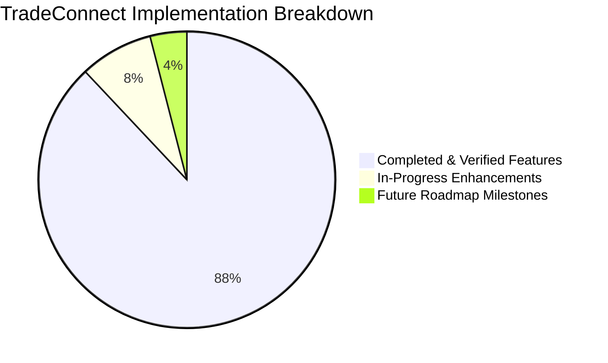

# Chapter 13: Progress Tracker, Audit Checklist & Future Milestones

---

## 13.1 Implementation Progress Tracker

This document maintains an accurate, verified record of implemented features, active items, and planned enhancements across all platform subsystems.

---

## 13.2 Subsystem Audit & Verification Checklist

### 1. Authentication & Security Subsystem
- [x] Custom `User` model with email-first authentication (no username required).
- [x] Cryptographic password reset workflow with secure token expiration.
- [x] Account activation and verification token management.
- [x] 5-attempt failed login security lockout with Super Admin security alerts.
- [x] JWT token issuance (30-minute access token, 7-day refresh token with rotation).
- [x] Immediate company suspension session eviction via `CompanySuspensionMiddleware`.

### 2. Multi-Tenancy & RBAC Subsystem
- [x] Organization profiles supporting `BUYER`, `SELLER`, and `BOTH` company types.
- [x] Company verification workflow with GSTIN/VAT and business registration audits.
- [x] Granular role and permission tables (`CompanyRole`, `RolePermission`, `MemberPermission`).
- [x] Multi-tenant database query scoping on `request.user.company`.
- [x] Super Admin company impersonation with seamless exit mechanism.

### 3. Buyer & Procurement Desk
- [x] Procurement requirements CRUD with specifications, target pricing, and deadlines.
- [x] Batch requirements CSV import with downloadable sample template.
- [x] Autonomous AI supplier discovery querying internal catalogs and external web registries.
- [x] Direct and batch RFQ dispatch to discovered vendors.
- [x] Threaded negotiation messaging and quotation price comparison matrix.
- [x] Export of procurement dossiers and supplier reports as CSV.

### 4. Seller & Sales Desk
- [x] Product catalog management with SKU codes, bulk pricing, and image galleries.
- [x] Product availability toggles and batch CSV import/export.
- [x] High-intent buyer lead discovery matching seller catalog items.
- [x] Binding quotation recording with validity periods and payment terms.
- [x] Programmatic PDF quotation generation using ReportLab (`inquiry_quotation_pdf_view`).

### 5. AI Cognitive & Cloud Failover Gateway
- [x] Primary AI generation using Google Gemini 2.5 Flash (`gemini-2.5-flash`).
- [x] Automated Cloud Failover to OpenAI GPT-4o-mini (`gpt-4o-mini`) on HTTP 429, 503, or timeout.
- [x] Multi-parameter match scoring engine with dynamic criteria weighting.
- [x] API latency, status code, and failover telemetry recorded in `APILog`.
- [x] Autonomous background web scrapers with BeautifulSoup and Playwright fallbacks.

### 6. Financial Ledger & Subscription Billing
- [x] Dedicated prepaid `CompanyCreditWallet` with categorized balances.
- [x] Atomic credit deductions using `select_for_update()` transaction locks.
- [x] Configurable per-feature credit costs (`FeatureCreditCost`).
- [x] Subscription plans catalog with monthly, yearly, and lifetime billing cycles.
- [x] Automated GST tax invoice generation (`Invoice`).
- [x] Super Admin manual wallet adjustment API with operator audit trails.

### 7. Centralized Email Notification Management
- [x] 21 standardized operational events across User, Company Admin, and Super Admin categories.
- [x] Delivery mode enforcement: `AUTOMATIC` (event-only), `MANUAL` (UI-only), `BOTH` (dual-mode).
- [x] Mandatory security rule protection (`is_mandatory_auth=True`) preventing deactivation of auth emails.
- [x] Strict user email preference guard in `email_engine.py` preventing outbox creation for non-mandatory opted-out categories.
- [x] Outbox worker self-healing: Automatic reclamation of stalled `SENDING` logs (>10m) back to `QUEUED` with `--recover-stale`.
- [x] Credit threshold and cooldown window enforcement for `billing.credits_low`.
- [x] Centralized Super Admin console (`/admin-panel/email/triggers/`) with category filters and delivery telemetry.
- [x] Pre-save Django Template syntax validation in Super Admin template edit view preventing broken tag saves.
- [x] Real-time JSON preview API and immediate test-send endpoint.
- [x] Responsive 2-card master email layout with brand header, hero banner, trust badges, and dark footer.
- [x] RFC 8058 One-Click Unsubscribe compliance.

### 8. In-App System Notification Center
- [x] Header notification bell 🔔 with live unread badge and smart Page Visibility throttling (20s foreground, 120s background).
- [x] Dropdown with recent notifications, click-through navigation, and quick "Mark all read".
- [x] Dedicated full-screen Notification Inbox page (`/notifications/inbox/`).
- [x] Multi-select batch operations toolbar: Select all, batch mark read, batch mark unread, and batch archive with tenant boundary enforcement.
- [x] Tab-based filtering: All, Unread, Read, Important (Warning/Critical), and Archived.
- [x] Priority indicators (`INFO`, `SUCCESS`, `WARNING`, `CRITICAL`) with domain-specific FontAwesome 6 icons.
- [x] DRF REST API endpoints: list, unread-count, mark-read, mark-unread, mark-all-read, bulk-action, and archive/delete.
- [x] Multi-channel delivery rules: `IN_APP`, `EMAIL`, and `BOTH` with role and user preferences.
- [x] Strict tenant and user data isolation preventing cross-company visibility.

### 9. Web Push Notification Subsystem (Firebase Cloud Messaging)
- [x] Firebase Admin SDK integrated with environment configuration and lazy initialization.
- [x] Multi-device token management via `DeviceToken` model (user, browser/OS user agent, IP address, active status).
- [x] Unified delivery channels: `EMAIL`, `IN_APP`, `PUSH`, `BOTH`, `IN_APP_PUSH`, and `ALL`.
- [x] Dedicated REST APIs: push public config, device token registration, device unregistration, and authorized test push.
- [x] Root Service Worker served via Django view (`/firebase-messaging-sw.js`) with `Service-Worker-Allowed: /` header.
- [x] UI desktop opt-in banner in notification bell dropdown with permission request handler.
- [x] Foreground toast banner alerts and background OS notifications with click-through navigation.
- [x] Multi-tenant isolation: Push suppression for inactive/suspended companies.
- [x] Automatic stale token pruning on FCM deregistration errors.
- [x] User-level notification preferences with independent Web Push toggle control.

### 10. Testing & Quality Assurance
- [x] Complete notification app test suite passing (67 verified tests, 0 failures, 0 regressions).
- [x] Full platform regression suite passing (227 tests across companies, catalog, leads, dashboard, notifications).
- [x] Multi-tier role verification: User/Company User, Company Admin, Super Admin.
- [x] Company-type verification: Sales/Buyer, Vendor/Seller, Both.
- [x] Automated test database preservation (`--keepdb`).
- [x] Deterministic mocking for third-party SMTP, AI providers, payment gateways, and Firebase FCM Admin SDK.

---

## 13.3 Summary of Status Categories

### Completed & Fully Verified Items (Production Ready)
- Authentication, Multi-Tenancy, RBAC, Requirements CRUD, Catalog CRUD, AI Failover Gateway, RFQ Inquiries, PDF Quotations, Credit Wallets, Centralized Notification Management (21 events), In-App Notification Center & REST APIs, Firebase Web Push Notifications (FCM), and Automated Test Suites (63 notification tests, 222 total platform tests passing).

### In-Progress & Minor Optimization Items
- Production Redis deployment configuration for Celery outbox tasks.
- Advanced AI crawler support for regional foreign language supplier registries.
- Webhook endpoints for live production Razorpay and Stripe event reconciliation.

### Future Roadmap Milestones (Planned)
- WebSocket-powered live real-time chat for RFQ negotiations.
- Native mobile application API optimization (Push notification service integration).
- Multi-currency dynamic forex conversion for cross-border international trade.
