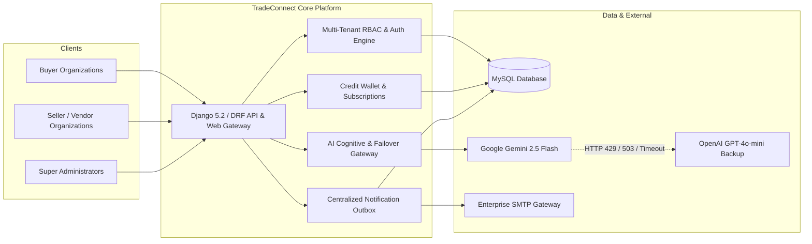

# TradeConnect B2B AI Procurement & Sales Platform
## Engineering Documentation System & Architecture Handbook

Welcome to the official technical documentation for **TradeConnect** (Procurement AI) — an enterprise-grade, multi-tenant B2B AI Procurement and Sales Intelligence Platform built with **Django 5.2**, **Django REST Framework (DRF)**, **MySQL**, and a dual-engine **AI Cognitive & Cloud Failover Gateway (Google Gemini 2.5 Flash + OpenAI GPT-4o-mini)**.

---

### Documentation Index & Reading Guide

This documentation system is structured into 13 modular handbooks designed for engineers, architects, DevOps professionals, and technical interview candidates.

| Chapter | Document Title | Description & Target Audience |
| :---: | :--- | :--- |
| **01** | [**01. Project Overview**](01_PROJECT_OVERVIEW.md) | Platform identity, business mission, core value proposition, user personas, and capability matrix. |
| **02** | [**02. Development Roadmap**](02_DEVELOPMENT_ROADMAP.md) | Chronological development history verified from Git commits, evolution phases, and milestones. |
| **03** | [**03. System Architecture**](03_SYSTEM_ARCHITECTURE.md) | 5-Tier architectural model, dual-engine AI gateway, middleware stack, and data flow diagrams. |
| **04** | [**04. Database Design & ERD**](04_DATABASE_DESIGN_AND_ERD.md) | Complete 49-model database dictionary, Mermaid ERDs, relationship schemas, and indexing strategies. |
| **05** | [**05. Code Explanation & Modules**](05_CODE_EXPLANATION_AND_MODULES.md) | Deep beginner-friendly explanation of all 9 local Django apps, inputs, outputs, and internal mechanics. |
| **06** | [**06. API Documentation**](06_API_DOCUMENTATION.md) | Complete REST API specification with HTTP methods, request bodies, responses, and JWT auth rules. |
| **07** | [**07. Setup & Installation Guide**](07_SETUP_AND_INSTALLATION_GUIDE.md) | Step-by-step Windows and cross-platform installation, virtualenv setup, MySQL database configuration, and environment vars. |
| **08** | [**08. Testing & Quality Assurance**](08_TESTING_AND_QUALITY_ASSURANCE.md) | Test suite breakdown, verified test execution commands, mocking strategies, and regression prevention. |
| **09** | [**09. Security & Performance**](09_SECURITY_AND_PERFORMANCE.md) | Multi-tenant data isolation, RBAC security, mandatory auth lockouts, query optimization, and caching. |
| **10** | [**10. Deployment Guide**](10_DEPLOYMENT_GUIDE.md) | Production hardening, Gunicorn/Nginx setup, background Celery workers, SSL, and backup routines. |
| **11** | [**11. Troubleshooting & FAQ**](11_TROUBLESHOOTING_AND_FAQ.md) | Real-world error diagnostic guides (MySQL errors, AI API failover, SMTP issues, session timeouts). |
| **12** | [**12. Interview Preparation Handbook**](12_INTERVIEW_PREPARATION_HANDBOOK.md) | 1-minute pitch, 5-minute deep-dive, design decision rationale, and 25+ technical interview Q&A. |
| **13** | [**13. Progress Tracker & Checklist**](13_PROGRESS_TRACKER_AND_CHECKLIST.md) | Implementation status checklist, verified features, pending milestones, and delivery audit. |

---

### Executive Summary

TradeConnect revolutionizes B2B commerce by bridging enterprise procurement buyers and industrial suppliers through autonomous AI-powered search, structured RFQ (Request for Quotation) workflows, multi-currency credit ledgers, and centralized notification policies.

---

### Quick Facts

- **Framework**: Django 5.2.17, Django REST Framework 3.18.1
- **Database**: MySQL 8.0 with InnoDB Engine & UTF8mb4 Charset
- **Primary AI Model**: Google Gemini 2.5 Flash
- **Secondary AI Model (Failover)**: OpenAI GPT-4o-mini
- **Authentication**: JWT (JSON Web Tokens) with 30-min access / 7-day rotation & Django Session Authentication
- **Email Dispatch**: Standard SMTP with RFC 8058 One-Click Unsubscribe & Outbox Retries
- **Local PDF Documentation**: `docs/TradeConnect_Master_Handbook.pdf`
