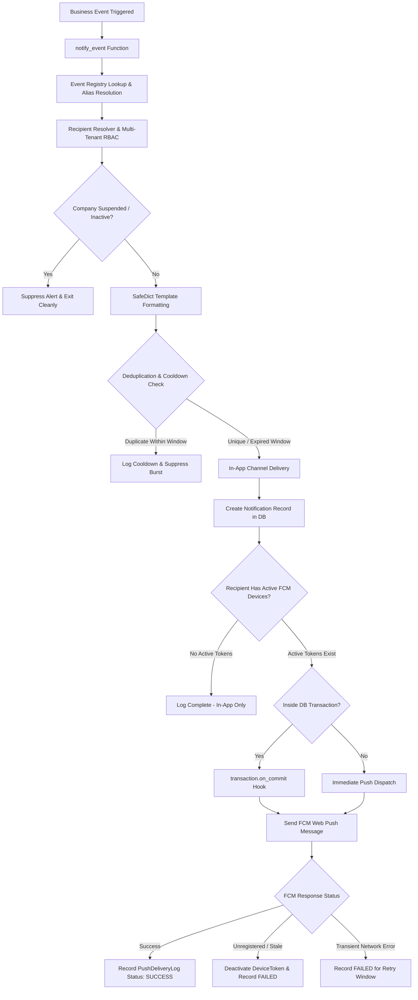

# Centralized Notification Engine Architecture & Operational Guide
**AI Procurement & Sales B2B Platform**
*Authoritative Documentation for In-App System and Firebase Cloud Messaging (FCM) Web Push Delivery*

---

## 1. Executive Architecture Summary

The **Centralized Notification Engine** is the platform's unified, event-driven subsystem responsible for delivering real-time **In-App/System Notifications** and **Firebase Cloud Messaging (FCM) Web Push Notifications** across 48 mission-critical business events.

Rather than fragmenting notification logic across individual view controllers and models, all triggers execute through a single entry point:
```python
notify_event(
    event,
    recipient=None,
    recipients=None,
    company=None,
    data=None,
    dedupe_key=None,
    channels=None,
    actor=None,
    custom_title=None,
    custom_message=None,
    custom_url=None,
    priority=None,
    async_push=True,
)
```

### Fundamental Architecture Principles
1. **Zero Email Interference**: Transactional email (SMTP) operates through its existing isolated engine (`apps.notifications.services.email_engine`). Email templates, SMTP routing, and transactional triggers remain completely decoupled. The only touchpoint is failure telemetry: an unrecoverable email delivery failure alerts Super Admins via `platform.email_delivery_failure`.
2. **Standardized Terminology**: Consistent B2B domain terms across all payloads, notifications, and UI contexts:
   - **Customer** (Procurement / Buyer workspace)
   - **Vendor** (Sales / Supplier workspace)
   - **Customer + Vendor** (Dual-workspace enterprise company)
3. **Multi-Tenant Boundary Isolation**: Recipient resolution strictly respects company workspace boundaries. Customer operations never emit notifications or tokens to Vendor counterparties without explicit commercial cross-company triggers (e.g. RFQ dispatch).
4. **Transactional Safety (`transaction.on_commit`)**: Push notifications are never dispatched for uncommitted database transactions. When executed inside an atomic transaction block, push delivery is automatically deferred until transaction commit.
5. **Safe String Interpolation (`SafeDict`)**: Prevents arbitrary code execution or template injection. Placeholders `{key}` are evaluated against a sanitized dictionary; unmapped keys remain verbatim `{missing_key}` without raising exceptions.
6. **Self-Healing Token Registry**: FCM push delivery monitors error codes. Devices returning `UNREGISTERED`, `INVALID_ARGUMENT`, or `REGISTRATION_TOKEN_NOT_REGISTERED` have their `DeviceToken.is_active` set to `False` automatically.

---

## 2. End-to-End Notification Lifecycle



---

## 3. Core Engine Components

### 3.1 Event Registry (`apps/notifications/services/event_registry.py`)
The authoritative catalog of all 48 business events categorized by role:
- **Events 1 to 20**: User / Company User
- **Events 21 to 34**: Company Admin
- **Events 35 to 48**: Super Admin

Each registry definition encapsulates:
- `title_template`: Format string for alert headline
- `message_template`: Format string for alert summary
- `category`: Category mapped to `NotificationPreference.Category`
- `priority`: `Notification.Priority` (`INFO`, `SUCCESS`, `WARNING`, `CRITICAL`)
- `audience`: Target resolution rule (`USER`, `COMPANY_ADMINS`, `SUPER_ADMINS`, etc.)
- `default_url`: Deep-link path for action
- `channels`: `["in_app", "push"]`
- `icon` & `color`: Tailwind/FontAwesome visual tokens
- `cooldown_minutes`: Burst-prevention window (default 15m; up to 1440m for billing)
- `is_mandatory`: If `True`, bypasses user preference opt-outs (security and regulatory events)

### 3.2 Notification Engine Service (`apps/notifications/services/notification_engine.py`)
Executes the centralized 10-step dispatch pipeline:
1. Resolves event keys and backward-compatible aliases via `get_event_definition()`.
2. Validates company active status, suppressing alerts if company is suspended.
3. Resolves recipient user list based on RBAC, company permissions, and audience.
4. Interpolates placeholders using `_format_safe_template` and `SafeDict`.
5. Checks deduplication key within `cooldown_minutes`.
6. Checks user category opt-outs via `NotificationPreference` (skipping if `is_mandatory=True`).
7. Persists `dashboard.Notification` record with `is_read=False`.
8. Dispatches FCM push payloads via `send_user_push()`.
9. Logs per-device delivery audit in `PushDeliveryLog`.
10. Automatically prunes stale device tokens on permanent FCM delivery failures.

### 3.3 Dynamic Dispatch Wrapper (`apps/notifications/services/dynamic_engine.py`)
Provides full backward compatibility for legacy callers invoking `dispatch_dynamic_notification()`. Delegates directly into `notify_event()` with synchronous delivery flags.

### 3.4 FCM Service Integration (`apps/notifications/services/fcm_service.py`)
Handles Firebase Admin SDK communication:
- Reads credentials from configured service account JSON.
- Builds standard Web Push notification and data payloads (`click_action`, `tag`, `icon`).
- Multicasts messages across all active device tokens for the recipient.
- Returns per-device response codes (`device_results`).

---

## 4. Multi-Tenant Isolation & Role-Based Rules

| Role / Tenant Scope | Access Permissions | Notification Isolation Boundary |
| :--- | :--- | :--- |
| **Customer** | Procurement, RFQ management, supplier search, quotes | Isolated to customer's company workspace. Only counterparty vendor sees explicit inquiries. |
| **Vendor** | Catalog, products, lead management, sales inquiries | Isolated to vendor's company workspace. Never receives customer internal procurement notifications. |
| **Customer + Vendor** | Full dual-workspace capabilities | Dynamically routed based on active module context and company permissions. |
| **Company Admin** | Team member management, billing, subscriptions, credits | Receives organizational alerts (credit thresholds, user additions, subscription status). |
| **Super Admin** | Platform-wide governance, security, system telemetry | Receives global platform exceptions, audit events, verification requests, and payment failures. |

---

## 5. Deduplication & Idempotency Strategy

To prevent alert storms and duplicate notifications during high-frequency operations, `notify_event()` enforces a multi-tier deduplication check:
1. **Explicit Key**: Caller supplies a deterministic `dedupe_key` (e.g. `pay_conf_45`, `req_chg_12_closed`).
2. **Implicit Key Fallback**: The engine computes:
   `f"{resolved_key}:{data_id}:{target_user.id}"`
3. **Database Constraint & Window Query**:
   `Notification.objects.filter(user=target_user, deduplication_key=effective_dedupe, created_at__gte=cutoff).exists()`
   If found within `cooldown_minutes`, the notification is recorded as `suppressed=True` without writing duplicate rows or sending push alerts.

---

## 6. Device Token Lifecycle & Self-Healing

1. **Registration**: Frontend service worker calls `api/notifications/fcm/register/` to store device token, browser name, and device type.
2. **Dispatch**: FCM multicast sends push to all active tokens for target user.
3. **Auto-Pruning**: When FCM returns `UNREGISTERED` or `messaging/invalid-registration-token`, the engine automatically updates `DeviceToken.objects.filter(token=...).update(is_active=False)`.
4. **Audit Trail**: Every push attempt is immutably logged in `PushDeliveryLog` with status, device ID, timestamp, attempt count, and sanitized error messages.
